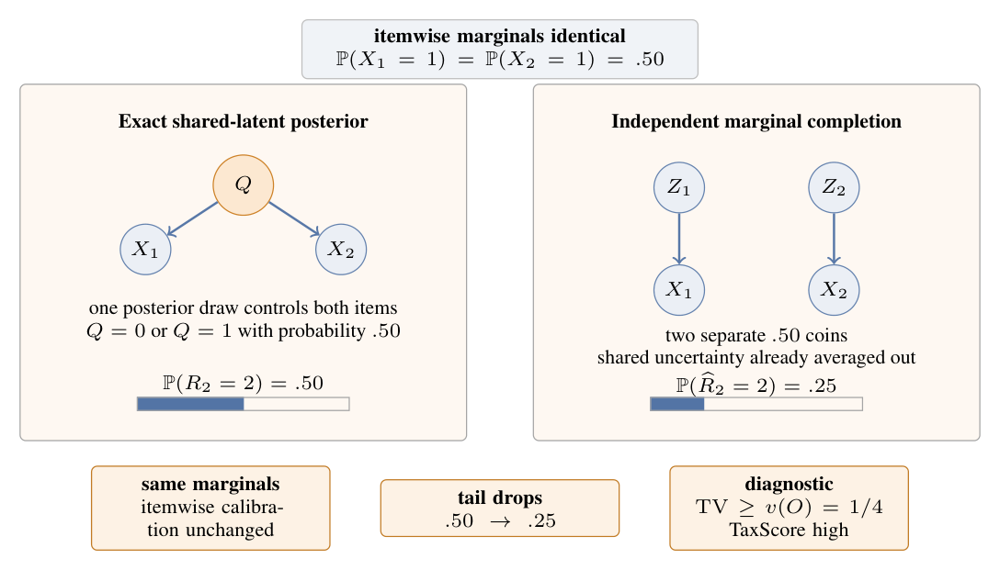
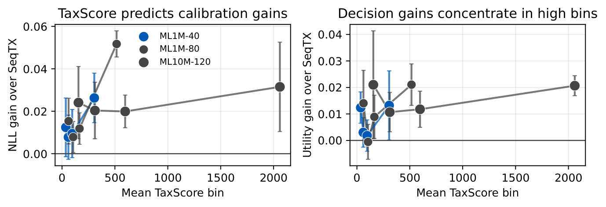
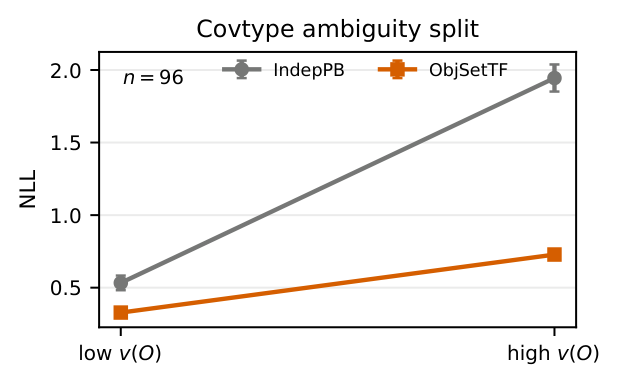
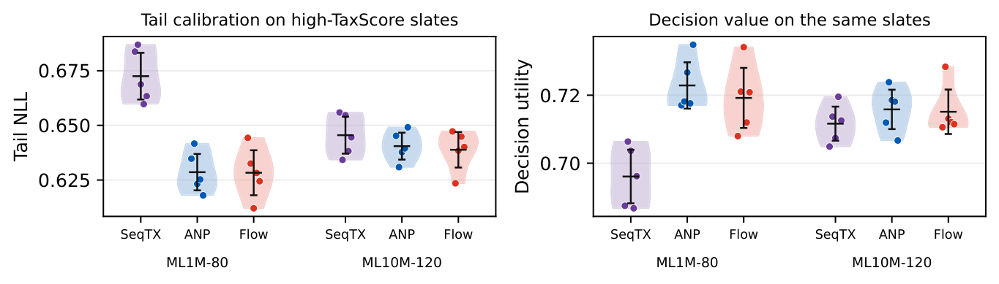

<h2 align="center">Serialization Tax in Shared-Latent Exchangeable Decisions</h2>

<p align="center">
  <a href="paper/serialization_tax.pdf"></a>
  <a href="https://github.com/SiminChang/Serialization-Tax-in-Shared-Latent-Exchangeable-Decisions"></a>
  <a href="results/aggregate_results.json"></a>
</p>

<p align="center">
  <a href="#news"><b>🎉 News</b></a> ·
  <a href="#links"><b>🔗 Links</b></a> ·
  <a href="#introduction"><b>📖 Introduction</b></a> ·
  <a href="#getting-started"><b>✨ Getting Started</b></a>
</p>
<p align="center">
  <a href="#usage"><b>🔧 Usage</b></a> ·
  <a href="#evaluation"><b>📃 Evaluation</b></a> ·
  <a href="#citation"><b>🎈 Citation</b></a> ·
  <a href="#acknowledgments"><b>🌻 Acknowledgments</b></a>
</p>

<p align="center">
  <b>Siming Zhang · Zhehui Shen · Shijie Chen · Xinle Gu · Yansen Yu · Hang Yu</b><br>
  Shanghai University<br>
  Corresponding author: <a href="mailto:yuhang@shu.edu.cn">Hang Yu</a>
</p>

---

<a id="news"></a>
## 🎉 News

- **[2026-11]** Our paper has been accepted to **NeurIPS 2026**. The paper, code, audit protocol, and experimental results are available here.

<a id="links"></a>
## 🔗 Links

- 📜 [Paper](paper/serialization_tax.pdf)
- 📊 [Experimental results](results/aggregate_results.json) · [Audit protocol](PROTOCOL.md)
- 💻 [GitHub](https://github.com/SiminChang/Serialization-Tax-in-Shared-Latent-Exchangeable-Decisions)

<a id="introduction"></a>
## 📖 Introduction



Accurate item probabilities can produce inaccurate group-level decisions. A system
may score each item separately, yet act on whether enough hidden items succeed.
When items share an uncertain latent state, independently averaging that state
preserves item means but removes dependence from the aggregate posterior.
We call this averaging-before-aggregation error the **serialization tax**.

**To our knowledge, this is the first unified formulation and analysis of this
averaging-before-aggregation failure for shared-latent aggregate tail decisions.**
The framework connects a posterior-interface law, a decision-aware diagnostic,
and an empirical routing audit.

- **The law:** For shared-rate binary items, convex order describes the lost aggregate uncertainty, with variance and total-variation consequences.
- **The diagnostic:** TaxScore combines hidden-block size, residual shared uncertainty, and proximity to a tail threshold.
- **The interface:** A shared posterior draw or mixture component is propagated through the whole hidden block before its tail probability is averaged.
- **The audit:** Compare probability quality, action value, and inference cost on the same pre-specified groups.

### How It Works

1. Specify the aggregate event and the decision payoff.
2. Compute a decision-time score using the revealed information.
3. Choose the routing rule on validation groups and evaluate it on held-out users.
4. Report flagged-slice gains, full-population switch gains, and inference overhead together.

## 🔍 Key Findings



The MovieLens audit finds larger tail-probability gains on high-score slates.
Its candidate-selection rules and routing score are separate, fully specified
computations. Hidden outcomes and predictions from the compared neural heads
are excluded from the score. The diagnostic is evaluated in a selected high-risk
regime, with low-score groups and full-population results providing context.

<p align="center">
  
</p>

At hidden size 96, Covtype independent-completion NLL rises from **0.533 to 1.945**
between low- and high-ambiguity prefixes. The object-space head rises from
**0.329 to 0.728**. This controlled mechanism check complements the real-data
MovieLens audit. Natural grouped tasks supply weak-gain boundary cases.

<a id="getting-started"></a>
## ✨ Getting Started

### Environment Setup

Use Python 3.11 or newer and a PyTorch build suitable for your machine.

```bash
git clone https://github.com/SiminChang/Serialization-Tax-in-Shared-Latent-Exchangeable-Decisions.git
cd Serialization-Tax-in-Shared-Latent-Exchangeable-Decisions
python -m pip install -r requirements.txt
```

### Reproduce Saved Figures and Tables

```bash
python -m unittest discover -s tests -v
python make_figures.py
python make_control_tables.py
```

These commands use saved metrics and perform no training or dataset downloads.
They generate outputs in `figures/`. The control-table generator checks paired
differences, positive-seed counts, equal routing budgets, and clean timing records.

<a id="usage"></a>
## 🔧 Usage

Run commands from the repository root. The original neural experiments used
CUDA. Repeat the following training commands with seeds 0 through 4 for the
five-seed evaluation. Each script provides `--help`.

```bash
python -c "from pathlib import Path; Path('runs').mkdir(exist_ok=True)"

# MovieLens 1M, 80 hidden items.
python movielens_tail_experiments.py --seed 0 --dataset ml1m \
  --config crit80:2:80:0.7:critical --models seqtx_count,anp,flow \
  --skip-finite-stress --output runs/ml1m_seed0.json

# Matched-backbone, fixed-ensemble, and equal-budget controls.
python attribution_experiment.py --seed 0 --dataset ml1m \
  --config crit80:2:80:0.7:critical \
  --models seqtx_count,seqtx_global,twotower_ens_mean,twotower_ens_mix,anp,flow \
  --skip-finite-stress --output runs/attribution_seed0.json

# Threshold robustness.
python movielens_tail_experiments.py --seed 0 --dataset ml1m \
  --config c060:2:80:0.60:critical c070:2:80:0.70:critical c075:2:80:0.75:critical \
  --models seqtx_count,flow --skip-finite-stress \
  --critical-margin 0.08 --critical-attempts 80 --prefix-weight 0.20 \
  --selector-mode default --output runs/threshold_seed0.json

# Semi-synthetic batch mechanism check.
python run_benchmarks.py --seed 0 --benchmarks batch_inspection --output-dir runs/seed_0
```

Proxy robustness varies `--selector-mode` (`default`, `prior_only`, `prefix_only`),
`--prefix-weight` (0.10/0.20/0.30), `--critical-margin` (0.05/0.08/0.10), and
`--critical-attempts` (40/80/160). The ML10M proxy sweep uses the bounded-user
subset recorded in the results metadata.

Aggregate five MovieLens runs with
`movielens_tail_experiments.py --aggregate FILE0 FILE1 FILE2 FILE3 FILE4 --output OUT`.
Use `aggregate_benchmarks.py` for grouped-task outputs.
`oracle_diagnostics.py` and `taxscore_experiments.py` provide controlled studies.
`benchmark_l20_latency.py` measures head inference on CUDA.

<a id="evaluation"></a>
## 📃 Evaluation



The table reports five-seed means on the pre-specified high-TaxScore slice.
Each NLL/utility pair belongs to the same model and setting.

| Setting | SeqTXCount NLL | ANP NLL | SeqTXCount utility | ANP utility |
| --- | ---: | ---: | ---: | ---: |
| MovieLens 1M, hidden size 80 | 0.673 | **0.629** | 0.696 | **0.723** |
| MovieLens 10M, hidden size 120 | 0.670 | **0.639** | 0.691 | **0.715** |

Lower negative log-likelihood (NLL) and higher utility indicate improvement.
The original budgeted switch gives **0.006–0.012 full-population utility gains**
across the reported settings. Cost and latency must be evaluated alongside these gains.

### Evaluation Protocol

Routing uses a fixed 16-point user-shift posterior and score
`n * v_hat / (abs(mu_bar - ceil(c*n)/n) + 0.03)^2`.
Candidate construction uses training popularity and revealed prefix outcomes.
Genres enter the prediction heads. [PROTOCOL.md](PROTOCOL.md) gives the exact
equations, allowed inputs, and split-specific slice definitions.

Utility is predict/defer payoff: correct prediction 1, error 0, deferral
`1 - lambda`, with `lambda = 0.30` for headline results. Confidence thresholds
are selected on validation users. Descriptive score ranks, the original
validation-cutoff switch, and exact-budget routing are distinct evaluations.
Head-only latency excludes scoring, data transfer, queueing, and scheduling.
The batch-inspection task is a semi-synthetic mechanism check.

### Repository Contents

- `results/aggregate_results.json`: aggregate metrics used by the plotting scripts.
- `results/plot_seed_metrics.json`: five-seed headline distributions.
- `results/controls/`: paired seed records and head-latency measurements.
- `paper/serialization_tax.pdf`: the manuscript, including proofs and supplementary results.
- `assets/`: display exports of the paper figures, preserving their plotted data and styling.

The repository contains the code and compact numerical artifacts. Dataset
loaders access GroupLens, scikit-learn/UCI, and the cited public MIL sources.
Obtain each dataset under its own terms. Datasets, trained checkpoints, caches,
and duplicate build outputs are excluded. Aggregates without individual seed
records support replotting, while independent reaggregation requires fresh runs.
The paper's cost-sensitivity ranges are summary-only evidence.

<a id="citation"></a>
## 🎈 Citation

If you use this work, please cite our NeurIPS 2026 paper:

```bibtex
@inproceedings{zhang2026serialization,
  title     = {Serialization Tax in Shared-Latent Exchangeable Decisions},
  author    = {Siming Zhang and Zhehui Shen and Shijie Chen and Xinle Gu and Yansen Yu and Hang Yu},
  booktitle = {Advances in Neural Information Processing Systems},
  year      = {2026}
}
```

<a id="acknowledgments"></a>
## 🌻 Acknowledgments

This work was supported by the National Key R&D Program of China (Grant No. 2025YFF0514701).
